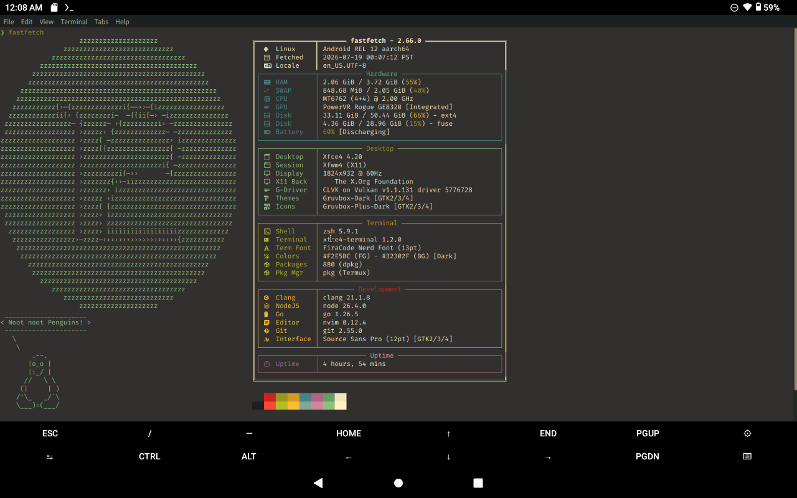

# android12-fastfetch

A [Fastfetch](https://github.com/fastfetch-cli/fastfetch) config tuned for **Android 12 / Termux** and native **X11 Termux desktops** (XFCE, MATE, LXQt, …). It draws a fixed-width table with hardware, desktop, terminal, development, and uptime sections, then prints the color palette.




## What's included

- `config.jsonc` — the Fastfetch config (JSONC, comments allowed)
- `ascii.txt` — the penguin ASCII logo referenced by the config

## Requirements

- [fastfetch](https://github.com/fastfetch-cli/fastfetch) — a recent version with JSON schema support
- A terminal with UTF-8, a Nerd Font, and truecolor for the icons and borders
- On Termux: `pkg install fastfetch` (or build from source)
- Optional, for the Desktop section: `xdpyinfo` and `xrandr` (missing commands show `Unknown` instead of failing)

## Install

```bash
git clone https://github.com/Mark44928/android12-fastfetch.git
cd android12-fastfetch

mkdir -p ~/.config/fastfetch
cp config.jsonc ~/.config/fastfetch/config.jsonc
cp ascii.txt ~/ascii.txt

fastfetch
```

Fastfetch reads `~/.config/fastfetch/config.jsonc` by default. The config points the logo at `~/ascii.txt`, so keep that path or edit `logo.source`.

### One-liner

```bash
mkdir -p ~/.config/fastfetch
curl -fsSL https://raw.githubusercontent.com/Mark44928/android12-fastfetch/main/config.jsonc -o ~/.config/fastfetch/config.jsonc
curl -fsSL https://raw.githubusercontent.com/Mark44928/android12-fastfetch/main/ascii.txt -o ~/ascii.txt
fastfetch
```

## Customize

- **Logo** — edit `logo.source` in `config.jsonc`. Set `"type": "builtin"` to use Fastfetch's built-in logos instead.
- **Disk folders** — edit `"folders": "/data:/storage/BC20-120B"` to match your storage. Most phones use `/data:/storage/emulated/0`; the SD-card UUID is different on every device.
- **Colors** — the config uses Gruvbox hex values. Change the `{##...}` colors to match your theme.
- **Sections** — remove or comment out modules you do not need (for example `battery`, `gpu`, `de`, or `wm`).
- **Key width** — the cursor constants (`\u001b[47D`, `\u001b[47C`, …) assume a 47-column value block. If you change the labels or width, adjust those constants too.

## Notes and troubleshooting

- The config is **JSONC**: comments are allowed. Fastfetch accepts it, but strict JSON tools may not.
- If icons render as boxes, install a Nerd Font and select it in your terminal.
- If the table is misaligned, use a monospace font and a wider terminal window.
- On non-Android systems, remove the Android-specific modules (`battery`, `/data` disk folder, Termux package manager).
- `xdpyinfo` comes from `x11-utils` on Debian/Ubuntu or the Termux X11 packages.
- The screenshot shows the author's SD-card path; your `disk` module will differ until you edit `folders`.

## License

No license file is included yet. If you want others to reuse this config, add a `LICENSE` (MIT is a common choice for dotfiles).
