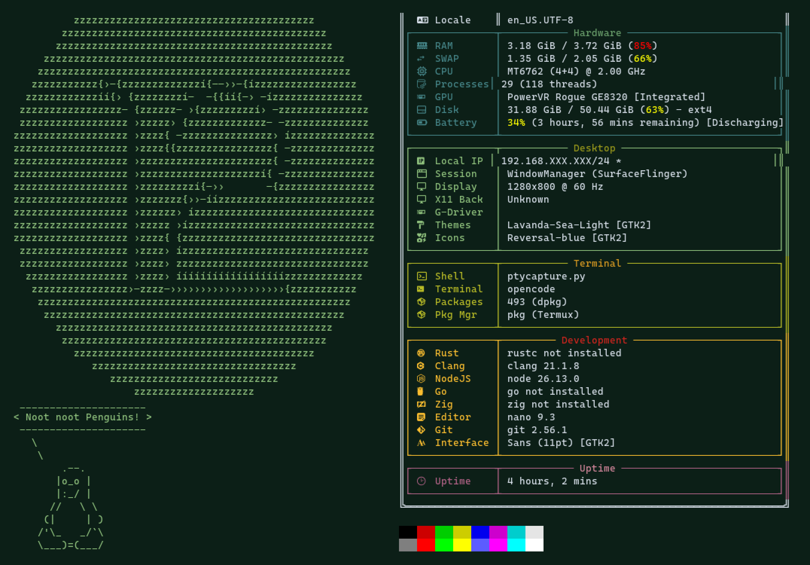
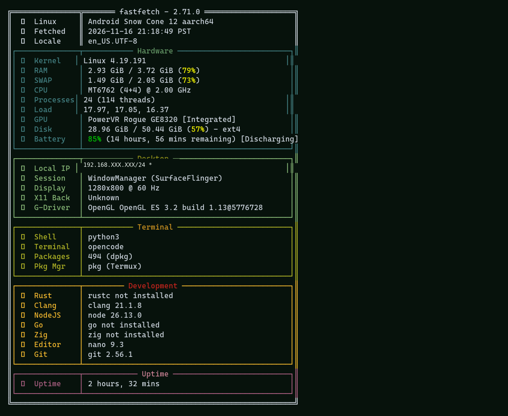
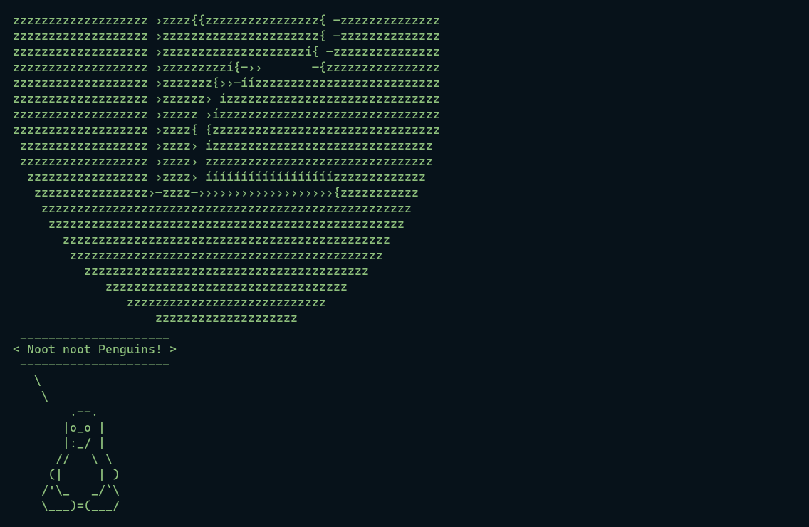

# android12-fastfetch

<p align="center"></p>

[](LICENSE)


A [Fastfetch](https://github.com/fastfetch-cli/fastfetch) config tuned for **Android 12 / Termux** and native **X11 Termux desktops** (XFCE, MATE, LXQt, …). It draws a fixed-width table with hardware, desktop, terminal, development, and uptime sections, then prints the color palette.

<p align="center"><i>Actual <code>fastfetch -c config.jsonc</code> run on the author's Android 12 Termux phone — fixed-width bordered table: hardware → desktop → terminal → development → uptime, with the Gruvbox palette at the bottom. Rendered with <a href="https://github.com/Mark44928/plusafetch/tree/main/scripts/ansi2png.py">plusafetch's <code>ptycapture + ansi2png</code></a> — numpy + Pillow, driven by a pty. Live state, not a template: RAM/battery/uptime drift between invocations.</i></p>





## What's included

- `config.jsonc` — the Fastfetch config (JSONC, comments allowed)
- `ascii.txt` — the penguin ASCII logo referenced by the config

## Requirements

- [fastfetch](https://github.com/fastfetch-cli/fastfetch) — **2.51.0 or newer** (JSONC config format); tested on 2.71.0
- A terminal with UTF-8, a Nerd Font, and truecolor for the icons and borders
- On Termux: `pkg install fastfetch` (or build from source)
- Optional, for the Desktop section: `xdpyinfo` and `xrandr` (missing commands show `Unknown` instead of failing)

> **Before 2.51.0?** The JSONC config format was not stable yet — upgrade with
> `pkg update && pkg upgrade fastfetch`, or fetch a release build from the
> fastfetch GitHub releases.

## Install

### Installer (backs up existing files)

```bash
bash install.sh              # fzf menu when available: full, minimal or SnakTUI
bash install.sh --minimal    # nine-row preset instead
bash install.sh --snaktui    # neon SnakTUI palette instead
```

The installer writes `~/.config/fastfetch/config.jsonc` and `~/ascii.txt`,
keeps timestamped backups of anything it replaces, and runs a render check.
It records both files in `$XDG_STATE_HOME/android12-fastfetch/installed.tsv`;
`bash install.sh --uninstall` removes them (or use `--keep-logo`).

### Manual

```bash
git clone https://github.com/Mark44928/android12-fastfetch.git
cd android12-fastfetch

mkdir -p ~/.config/fastfetch
cp config.jsonc ~/.config/fastfetch/config.jsonc
cp ascii.txt ~/ascii.txt

fastfetch
```

Fastfetch reads `~/.config/fastfetch/config.jsonc` by default. The config points the logo at `~/ascii.txt`, so keep that path or edit `logo.source`.

### Companion presets

`presets/minimal.jsonc` keeps the logo and Gruvbox key color but trims the
dashboard to nine rows (OS, kernel, uptime, packages, shell, terminal, memory,
disk, date). Run one without replacing your main config:

```bash
fastfetch -c presets/minimal.jsonc --pipe
```

Three terminal-theme presets ship alongside it, using the Greenit, Bluney and SnakTUI palettes, with matching logo tints:

```bash
fastfetch -c presets/greenit.jsonc --pipe
fastfetch -c presets/bluney.jsonc --pipe
fastfetch -c presets/snaktui.jsonc --pipe
```

### One-liner

```bash
mkdir -p ~/.config/fastfetch
curl -fsSL https://raw.githubusercontent.com/Mark44928/android12-fastfetch/main/config.jsonc -o ~/.config/fastfetch/config.jsonc
curl -fsSL https://raw.githubusercontent.com/Mark44928/android12-fastfetch/main/ascii.txt -o ~/ascii.txt
fastfetch
```

## Customize

- **Logo** — edit `logo.source` in `config.jsonc`. Set `"type": "builtin"` to use Fastfetch's built-in logos instead. `ascii.txt` is a penguin-style ASCII logo kept in `$HOME` (see its provenance note in [Notes](#notes-and-troubleshooting)).
- **Disk folders** — edit `"folders"` to match your storage. The default is `/data:/storage/emulated/0` (internal storage, works on every device); run `ls /storage` to discover an SD-card mount point like `/storage/0143-1A2B` and add it, colon-separated.
- **Colors** — the config uses Gruvbox hex values. Change the `{##...}` colors to match your theme.
- **Sections** — remove or comment out modules you do not need (for example `battery`, `gpu`, `localip`, or `wm`).
- **Key width** — the cursor constants (`\u001b[47D`, `\u001b[47C`, …) assume a 47-column value block. If you change the labels or width, adjust those constants too.

## Notes and troubleshooting

- The config is **JSONC**: comments are allowed. Fastfetch accepts it, but strict JSON tools may not.
- `$schema` is pinned to the **2.71.0 release tag** — bump it (and re-run `fastfetch`) when you upgrade fastfetch, so schema drift cannot silently invalidate the config.
- In a plain Termux shell the Desktop-section rows (Session, Display, WM Theme, Icons, Terminal Font, Terminal Theme, X11 Backend) print `Unknown` — they are only meaningful under Termux:X11. Delete that section if you never use X11; the command modules inside it already gate themselves with `system` conditionals.
- The two GPU rows are intentional: **GPU** is the hardware model, **G-Driver** is the driver/version detail.
- The **Hardware** section (`RAM`, `CPU`, …) also renders correctly in plain Termux — only the *desktop* rows need X11.
- `xdpyinfo` comes from `x11-utils` on Debian/Ubuntu or the Termux X11 packages.
- Long values (CPU model, Terminal Font, Theme strings) can push past the 47-column value block and shift the right border — shorten the terminal font/theme values, or wrap them in a per-module `format` if your device shows misaligned rows.
- **`ascii.txt` provenance:** the penguin-style logo was assembled by the repo author from ASCII penguin art in the style of the classic `pingu`/`cowsay` lineage; it is a configuration asset covered by the repo's MIT license, not a stock fastfetch logo.
- The Disk row in the preview assumes the default `/data:/storage/emulated/0` mount points; your `disk` module will print differently if you add a custom `folders` entry.

## Changelog

### Config v1.2.0
- **`Kernel` row** beside Chassis — running kernel release (`uname -r`)
- **`Load` row** in the Hardware section — 1/5/15-minute load averages, so
  the box's pressure is visible next to CPU and RAM (uptime and login rows
  stay in the Uptime section below)

### Config v1.1.0
- **`Processes` row** in the Hardware section (process + thread count) — the
  label keeps the fixed-width alignment, and the module works on plain Termux
  CLI, not just X11
- `$schema` pinned to the **2.71.0 release tag** instead of the moving `dev`
  branch, so schema drift cannot silently invalidate the config
- `disk.folders` defaults to `/data:/storage/emulated/0` (works on every
  device) instead of the author's SD-card UUID, with a comment explaining how
  to add your own mount point
- Desktop section documented as X11-only, and the two GPU rows
  (hardware model vs driver version) explained
- `ascii.txt` provenance/language added to the license note
- CI actually runs `fastfetch -c config.jsonc --pipe` on a real 2.71.0 binary
  and asserts the RAM/CPU/Disk rows render


## 🛠️ More from Mark44928

Tiny, dependency-free tools from the same family:

- [Pythonator](https://github.com/Mark44928/Pythonator) — Python rewrite of Plusalator — stdlib-only, `--eval`/`--json`
- [Solvamath](https://github.com/Mark44928/Solvamath) — terminal math puzzle game — seven puzzle types, daily seed, achievements
- [Bluney](https://github.com/Mark44928/Bluney) — blue-injected theme family — dark + light, single palette.json
- [Yellen](https://github.com/Mark44928/Yellen) — golden-yellow theme family — dark + light, single palette.json
- [Mark44928](https://github.com/Mark44928) — profile and project index
- [plusafetch](https://github.com/Mark44928/plusafetch) — C++23 fetch for Termux — ~23 ms, zero subprocesses on the default path
- [Plusalator](https://github.com/Mark44928/Plusalator) — C++17 calculator REPL — Qalculate-flavored, ghost autosuggest, 19 themes
- [GrubBlastersHTML](https://github.com/Mark44928/GrubBlastersHTML) — Turn-based artillery in one HTML file — 73 weapons, fully destructible terrain
- [SnakTUI](https://github.com/Mark44928/SnakTUI) — Snake game for the terminal — Textual + Python
- [Easy-Termux-Package-Manager](https://github.com/Mark44928/Easy-Termux-Package-Manager) — fzf-driven package manager for Termux — snapshots, audit, 194 tests
- [NoNameOS](https://github.com/Mark44928/NoNameOS) — OS simulation in a single C++17 file — virtual FS, real shell
- [Greenit](https://github.com/Mark44928/Greenit) — green-injected theme family — dark + light, single palette.json
- [CalculaHTML](https://github.com/Mark44928/CalculaHTML) — static HTML calculator — 16 themes + System mode, zero deps
- [debloat-android-tv](https://github.com/Mark44928/debloat-android-tv) — ADB debloat for rooted Android 9+ TV sticks & boxes
- [Android9-audios](https://github.com/Mark44928/Android9-audios) — 217 stock Android 9 system sounds + per-file SHA-256

## License

[MIT](LICENSE) — free to reuse, fork, or adapt. See [CONTRIBUTING.md](CONTRIBUTING.md)
to contribute; this project follows the standard [Code of Conduct](CODE_OF_CONDUCT.md).
